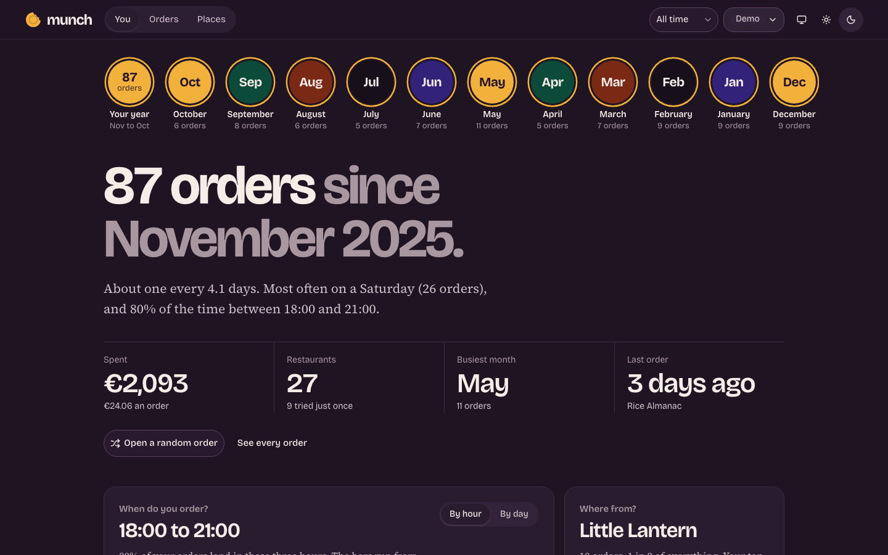
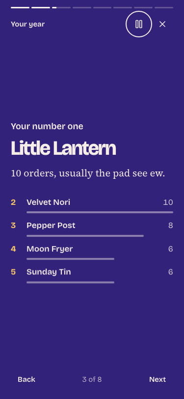
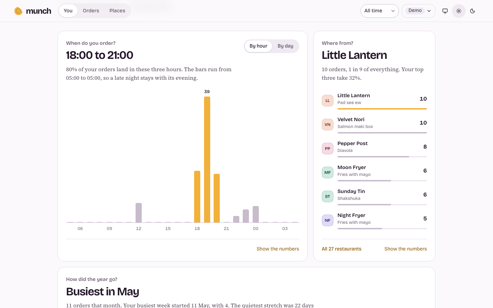
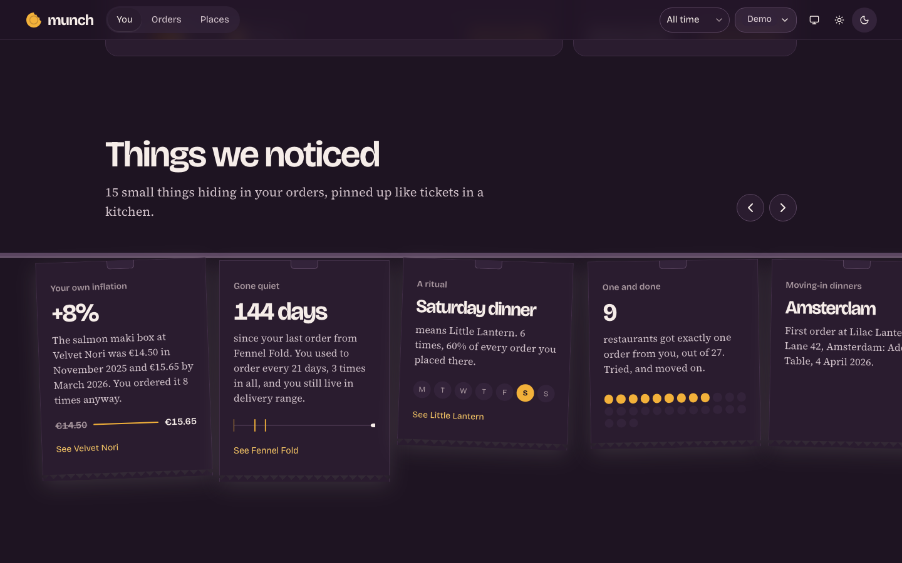
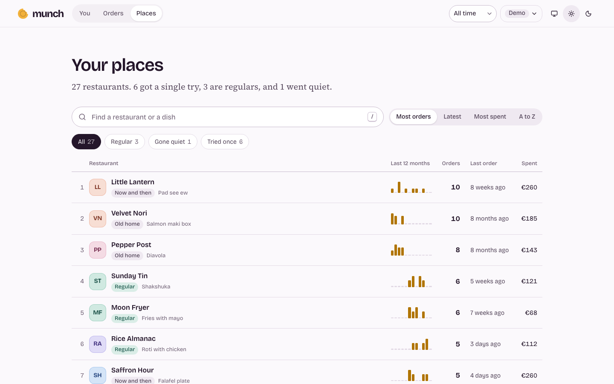
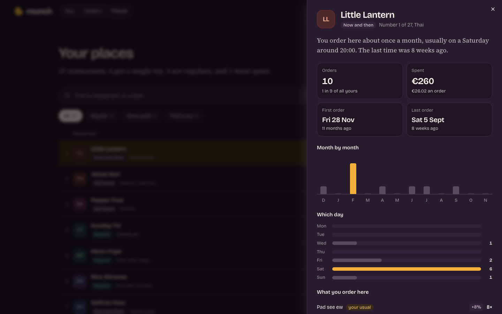

# Munch

**A year of dinners, read at a glance.**

Munch reads back your Thuisbezorgd order history: when you get hungry, the places you keep going back to, the one you quietly dropped, what an order really costs, and what you will probably order next. It runs entirely in your browser; your orders never leave your machine.

**[Try the demo at sriharsh.com/munch](https://sriharsh.com/munch/)**, with a made-up person's year of orders.



## What you get

### Stories

A row of story rings, like the stories in a messaging app: your whole year first, then each month, newest first. Tap one for a short story that plays itself: how often you ordered, your number one, the dish, peak hunger, new places, and what kind of orderer you were. Rings you have watched go quiet.

<p align="center"></p>

### Plain answers

Every card asks one question and answers it in large type, with the evidence underneath. When do you order? Where from? How did the year go, week by week? What does an order cost, and how much of it was fees? On your own, or for a group? Which days, and your longest run? Every bar opens the orders behind it, and every card turns into a table.



### Things we noticed

Small findings pinned up like kitchen tickets, each shown only when your history supports it: how much your usual dish has gone up, the place you stopped ordering from, a weekly ritual, your first dinner in a new home, the payday bump, your latest night.



### Every order, every place

Every order by month, with search that marks what it found and filters you can remove one at a time. Open one for its receipt and where it sits in your history. Every restaurant gets a status (regular, gone quiet, tried once), a year of activity, and a page of its own: your usual, which day, how the prices moved, every order.





### Your order type and your next order

A regular, an explorer, a night owl, the host, a weekender or clockwork, worked out from your own habits and shown with the numbers behind it. Then a guess at your next order, with how often the same guess would have been right on your past orders.

Thuisbezorgd keeps about a year of orders, so Munch is designed for a year: weeks rather than months, months as stories. Light and dark themes, keyboard support throughout, and reduced motion draws everything in place.

## Run it yourself

Install [Bun](https://bun.sh), then:

```sh
bun install
bun run dev
```

Open **http://localhost:5173**. If `data/orders.json` exists, the local app loads it. Otherwise choose **See the demo**, or open a Munch orders file. The demo contains a fixed-seed, made-up person's year of orders across two homes. Every restaurant and order in it is fictional.

## Get your orders

Use your own signed-in customer browser session. In DevTools, find the request that loads your order history and copy it as **cURL (bash)**. Keep it on the clipboard, then run:

```sh
bun run munch probe orders
bun run munch fetch
bun run munch build
bun run munch check
```

`bun run munch check --coverage` adds counts of which fields your file fills in, without printing any values.

The probe writes a redacted shape for parser development. Fetching follows the website's next-page links, one request at a time, and saves responses locally. Repeated fetches stop at an order already stored. `bun run munch fetch --full` refreshes every order in the returned listing. Reaching its end does not prove it includes your whole account history; an account data export is the fallback for older orders. Building runs locally and never needs your session again.

A rejected session stops the run. Copy a fresh request before trying again. If the website changes, the importer stops with field names and keeps the previous built file. The account data download is the fallback if the customer website becomes unreliable.

## Your data stays yours

Nothing is uploaded by the app. Fonts are self-hosted. Private responses, exports, copied requests and normalised orders are ignored by git. The dev server listens on this machine's loopback address.

The normalised file keeps the information needed for the story. It drops names, email addresses, phone numbers and street addresses. Homes use a coarse postcode area, city and opaque key. The local importer also writes private street-and-number display labels to an ignored sidecar; those labels stay out of the order export and public build. You can rename any home in the browser. An opened file is kept in this browser's IndexedDB; use **Forget my file** in the data menu to remove it.

The CLI keeps session headers in memory and never prints them. Do not paste a copied cURL into a chat, an issue or a commit.

## How it works

One TypeScript core holds the schema, analysis and predictions. The CLI fetches raw responses before normalising them into a versioned JSON file. The React app validates that file at the boundary and runs the analysis locally.

Charts are small hand-built HTML and SVG, with d3 for maths only; Motion handles the stories. Controls use shadcn and Radix. Design values come from `design/tokens.json`; generated CSS is checked in. The public static build includes only the fictional demo.

```sh
bun test
bun run typecheck
bun run tokens
bun run munch demo
bun run build
```

See [DESIGN.md](DESIGN.md), the [build plan](docs/plan.md) and [decisions](docs/decisions/) for the project's choices. Publication of the customer-site adapter remains subject to the review described in [AGENTS.md](AGENTS.md).

## Screenshots

All screenshots use the fictional demo.

| | Light | Dark |
| --- | --- | --- |
| Home | [1440px](docs/screenshots/home-1440-light.png), [375px](docs/screenshots/home-375-light.png) | [1440px](docs/screenshots/home-1440-dark.png), [375px](docs/screenshots/home-375-dark.png) |
| Question cards | [1440px](docs/screenshots/cards-1440-light.png), [375px](docs/screenshots/cards-375-light.png) | [1440px](docs/screenshots/cards-1440-dark.png), [375px](docs/screenshots/cards-375-dark.png) |
| A story | [1440px](docs/screenshots/story-places-1440-light.png), [375px](docs/screenshots/story-places-375-light.png) | [1440px](docs/screenshots/story-places-1440-dark.png), [375px](docs/screenshots/story-places-375-dark.png) |
| Things we noticed | [1440px](docs/screenshots/rail-1440-light.png), [375px](docs/screenshots/rail-375-light.png) | [1440px](docs/screenshots/rail-1440-dark.png), [375px](docs/screenshots/rail-375-dark.png) |
| Every order | [1440px](docs/screenshots/orders-1440-light.png), [375px](docs/screenshots/orders-375-light.png) | [1440px](docs/screenshots/orders-1440-dark.png), [375px](docs/screenshots/orders-375-dark.png) |
| One order | [1440px](docs/screenshots/order-1440-light.png), [375px](docs/screenshots/order-375-light.png) | [1440px](docs/screenshots/order-1440-dark.png), [375px](docs/screenshots/order-375-dark.png) |
| Your places | [1440px](docs/screenshots/places-1440-light.png), [375px](docs/screenshots/places-375-light.png) | [1440px](docs/screenshots/places-1440-dark.png), [375px](docs/screenshots/places-375-dark.png) |
| One place | [1440px](docs/screenshots/place-1440-light.png), [375px](docs/screenshots/place-375-light.png) | [1440px](docs/screenshots/place-1440-dark.png), [375px](docs/screenshots/place-375-dark.png) |

To retake them, run the app with the demo only and the screenshot script:

```sh
MUNCH_DEMO_ONLY=1 bunx vite --port 5199
SCALE=1 SHOTS=home,cards,story-places,rail,orders,order,places,place bun scripts/screenshots.ts http://localhost:5199
```

## Deploy

The public site is a static build with the demo only, served at `sriharsh.com/munch/` by a Cloudflare Worker with static assets:

```sh
bun run deploy   # builds under /munch/ into dist/, then wrangler deploy
```

## Licence

[MIT](LICENSE).
